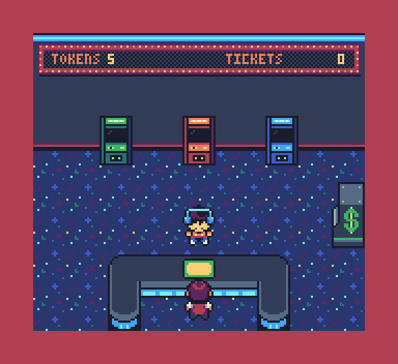
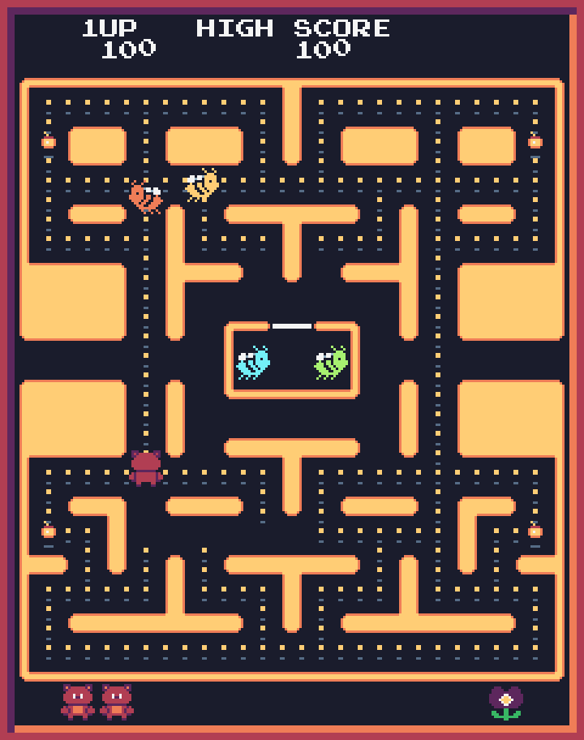
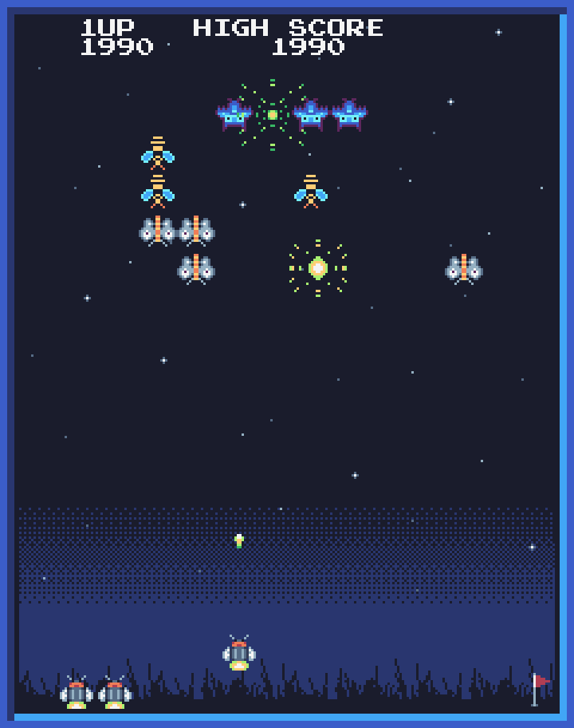
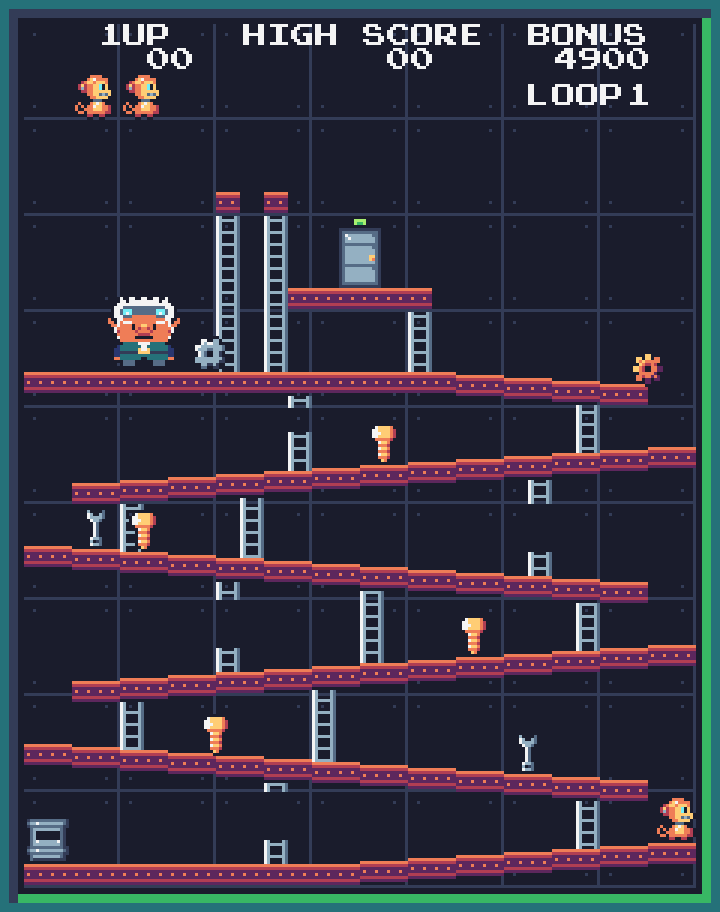

# Arcade

**[▶ Play it in your browser](https://arcade.dannyobrien.dev/)** · [](https://github.com/danmcfan/arcade/actions/workflows/deploy.yml)

Pixel art games within a game. Walk around an arcade, step up to a cabinet, and play the minigame inside.

<p align="center"></p>

| Sweet Sam                                                                        | Firefly                                                                   | Brass Monkey                                                              |
| -------------------------------------------------------------------------------- | ------------------------------------------------------------------------- | ------------------------------------------------------------------------- |
|                  |               |     |
| A Pac-Man-like maze: a bear eats its way past bees, true to the arcade original. | A Galaga-like shooter: a firefly takes on swooping moths, wasps and owls. | A Donkey Kong-like climb: a brass robot monkey escapes a gnome's factory. |

Win tickets in the minigames and spend them at the prize counter. Your hub progress and high scores are saved in the browser.

## Controls

| Key               | Action                                            |
| ----------------- | ------------------------------------------------- |
| WASD / arrow keys | Move; choose in menus                             |
| Space             | Interact / action; confirm in menus               |
| Esc               | Leave a minigame; in the hub, open the pause menu |

It needs a keyboard; phones and tablets get a notice instead.

## How it's made

- **TypeScript on a plain `<canvas>`.** No game engine, no framework and no runtime dependencies: just a fixed 60-ticks-per-second loop over Canvas 2D.
- **Art and music written as code.** Every sprite, the hub room, the pixel font and the title logo are rows of palette letters or ASCII in the source, in the [Sweetie 16](https://lospec.com/palette-list/sweetie-16) palette by GrafxKid. The title music and menu sounds are chiptune written as notes. Generator scripts turn them into PNGs and WAVs, and a test fails if the committed files drift from their source.
- **Deterministic and testable.** Seeded RNG and fixed ticks mean a game plays out the same way every time. With `?debug` in the URL, a test hook can step frames, script input and read state, which drives the browser checks and the screenshots on this page.
- **[Bun](https://bun.sh/)** builds, serves and tests it. Every push to `main` runs the full check (strict `tsc`, Oxlint, Prettier, knip, tests, build) and then deploys to GitHub Pages.
- **A port.** It started as a Go game and was ported to TypeScript. `docs/port-notes.md` records the differences.

## Run it locally

Requires [Bun](https://bun.sh/) 1.4.2.

```sh
bun install
bun run dev      # http://localhost:3000 with hot reload
bun test
```

<details>
<summary>All scripts</summary>

```sh
bun run build    # production bundle in dist/
bun run preview  # serve dist/
bun run check    # typecheck, lint, format check, knip, tests and build, as CI does
bun run format   # rewrite files in Prettier style
bun run art      # regenerate the pixel art PNGs from their source
bun run sounds   # regenerate the title music and menu sounds
bun run pixel    # inspect art: rows, colours, before/after sheets
```

`?scene=game` skips the title screen. `?debug` installs the `window.__arcade` test hook (contract: `src/engine/testhook.ts`), and Shift+P toggles hitboxes and a debug panel.

</details>

## Project layout

- `src/engine/`: canvas drawing, input, audio, assets, RNG, scaling, test hook
- `src/game/`: the top-level loop (hub plus active minigame) and scenes
- `src/title/`: title screen, intro, pause menu and save
- `src/ui/`: pixel font, logo, hub and player art, sounds
- `src/arcade/`: the hub
- `src/sweet-sam/`, `src/firefly/`, `src/brass-monkey/`: the minigames
- `scripts/`: art and sound generators and the browser capture harness
- `docs/`: design records (`docs/adr/`), port notes, and the workflow docs for coding agents (`docs/agents/`)

## License

[MIT](LICENSE)
